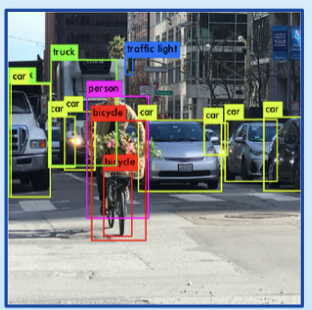
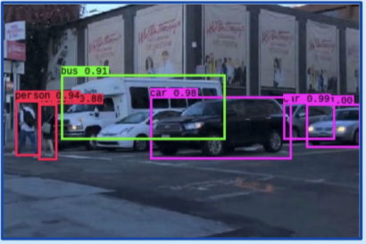
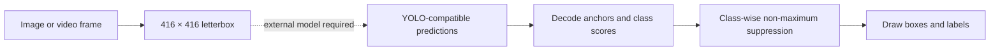

# Street Object Detection

**YOLOv3-style bounding-box decoding, suppression, and image/video annotation.**

This learning project explores the detection pipeline around YOLO predictions: letterbox an image, decode anchor-based outputs, filter overlapping boxes with intersection-over-union, and draw class labels. The source also includes a frame-by-frame OpenCV video loop and an 80-class COCO label list.

| Saved example 1 | Saved example 2 |
| --- | --- |
|  |  |

*These are qualitative outputs committed with the project, not an accuracy or speed benchmark.*

## What is implemented



- `preprocess_input`: resize and letterbox input images.
- `decode_netout` / `correct_yolo_boxes`: convert three-scale model outputs to image coordinates.
- `bbox_iou` / `do_nms`: compare boxes and suppress overlapping predictions.
- `draw_boxes`: render labels and boxes with Pillow.
- `detect_image` / `detect_video`: image inference and video-frame processing scaffolds.

## Explore the repository

```bash
git clone https://github.com/sudhanvad18/ObjectDetection.git
cd ObjectDetection
```

| Path | Contents |
| --- | --- |
| `ObjectDetection.py` | Notebook-style implementation and demonstration cells. |
| `data/image.jpg`, `data/image2.jpg` | Example input images. |
| `data/output1.png`, `data/output2.png` | Saved annotated outputs. |
| `data/video1.mp4` | Example input video. |

## Running inference

The current file is a **partial notebook export**, rather than a standalone command-line application. It references `darknet` and `yolo_outputs` without defining or loading the model that produces them. The architecture, pretrained weights, and model initialization must be restored before executing the image/video examples.

The imported dependencies are TensorFlow/Keras, OpenCV, NumPy, Pillow, Matplotlib, and `gdown`. The source additionally assumes:

- A TensorFlow-visible GPU; its top-level device check raises when none is found.
- Input media under `/content/data/`, which must be changed for a normal local clone.
- A Linux Liberation Mono font at the path in `draw_boxes`.
- A Pillow version supporting the legacy `ImageDraw.textsize` call, or an update to that drawing code.

Once model initialization and environment paths are configured, the existing `detect_image` and `detect_video` functions are the inference entry points. The video loop writes an MP4 with annotated frames. There is no `requirements.txt`, automated test suite, or verified dependency lockfile in this snapshot.

## Scope and next steps

The source demonstrates detection postprocessing and media handling. It does not include model training, a reproducible evaluation dataset split, or measured real-time throughput. The saved detections can contain misclassifications; a model-backed demo should record the weights, thresholds, environment, and input alongside its results.

The implementation follows YOLOv3-style outputs and uses COCO class names. Any restored model and weights should retain their original attribution and distribution terms.
